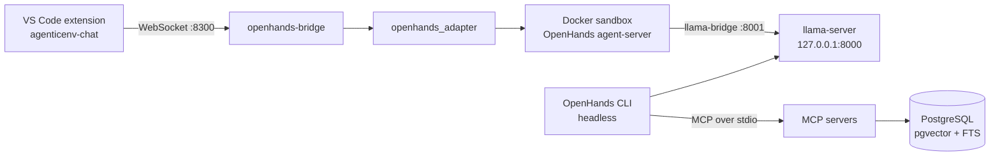

# AgenticEnv

A self-hosted agentic development environment for C++ quantitative libraries. It runs a local LLM,
an [OpenHands](https://github.com/OpenHands/OpenHands) agent in a disposable Docker sandbox, and a
set of purpose-built tools for C++ development and numerical verification. No code or prompt leaves
the machine for inference.

AgenticEnv is the workshop, not the product: its target is
[`quant-modeling`](https://github.com/HadrienT/quant-modeling), a C++ derivatives pricing library.

## Design principles

- **The LLM is not a source of numerical truth.** Financial calculations are performed by
  deterministic C++ code. The model writes code and calls tools; it does not compute results.
- **Reasoning is separated from execution.** Permissions are enforced at runtime by the harness,
  never through the prompt.
- **Knowledge is retrieved, not memorized.** The agent finds, tests and verifies, with cited sources.
- **The agent loop is not reimplemented.** OpenHands is the harness; this repository provides the
  infrastructure, tools and integration around it.

## Architecture



**Sandboxed sessions.** The user's folder is mounted read-only and the agent works on a full copy
inside the container, with a Git checkpoint at each turn. Changes reach the real repository only
through an explicit apply request; the copy is discarded with the container.

**Model serving.** `llama-server` serves a single GGUF model at a time through an OpenAI-compatible
API, fully in VRAM, and refuses to start without a CUDA device. Models are declared in a registry
([`configs/models.yaml`](configs/models.yaml)) and selected by profile:

| Profile | Model | Used by |
|---|---|---|
| `code` | Qwen3-Coder 30B-A3B (Q4_K_M) | OpenHands agent, quant-modeling assistant |
| `translate` | PLaMo 2 Translate (Q8_0) | live-subs |

**Network exposure.** `llama-server`, PostgreSQL and the bridge bind to `127.0.0.1` only. The
sandbox reaches the LLM through a proxy bound to the Docker bridge gateway.

## Repository layout

| Path | Contents |
|---|---|
| `packages/corelib` | Shared kernel: configuration, logging, errors, database access, units |
| `packages/cppdev` | C++ build, test, sanitizer and coverage tooling with condensed diagnostics (`cpp.*`) |
| `packages/codeintel` | clangd-backed code navigation for large repositories (`code.*`) |
| `packages/kbase` | Document ingestion and hybrid retrieval with provenance (`kb.*`) |
| `packages/agentmem` | Episodic and procedural agent memory (`mem.*`) |
| `packages/qmharness` | Numerical non-regression through `quant-modeling`'s pybind11 bindings (`qm.*`) |
| `packages/*-mcp` | Thin MCP servers exposing the five packages above |
| `packages/openhands_adapter` | OpenHands SDK integration: Docker sandbox and working copy |
| `packages/openhands-bridge` | WebSocket server for chat clients |
| `agents/` | Agent profiles, procedures, prompts and the OpenHands repository template |
| `benchmarks/golden/` | Reference cases for numerical non-regression |
| `configs/`, `migrations/`, `infra/` | Configuration, SQL schema, Docker, systemd and host scripts |
| `blueprint/` | Architecture and work package specifications (in French) |

Dependencies between packages are enforced by import-linter contracts in
[`pyproject.toml`](pyproject.toml).

## Getting started

The environment was built for a specific host: Debian 13 with two 16 GiB Tesla V100 GPUs,
the proprietary NVIDIA driver and CUDA 12.x. Paths and model sizing assume this setup.

**Requirements:** Python 3.12+, [uv](https://github.com/astral-sh/uv),
[just](https://github.com/casey/just), Docker, and a CUDA build of llama.cpp.

```bash
cp .env.example .env    # then set real credentials
just setup              # install the uv workspace
just db-up              # start PostgreSQL
just migrate            # apply SQL migrations
```

GGUF models, systemd units and host directories require a one-time setup described in the
[runbook](docs/runbook.md). Once it is complete:

```bash
just llm-use code       # select the model profile
just healthcheck        # verify the stack
just run-bridge         # serve chat clients on 127.0.0.1:8300
```

[`agenticenv-chat`](https://github.com/HadrienT/agenticenv-chat) is the matching VS Code client.

## Development

| Command | Purpose |
|---|---|
| `just lint` | ruff, `mypy --strict` for each package, import-linter |
| `just test` | Unit and contract tests |
| `just test-integration` | Adds the tests that require PostgreSQL |
| `just test-e2e` | OpenHands smoke test; requires Docker and `llama-server` |

Run `just --list` for all recipes. CI runs the lint and the tests that do not need the end-to-end
stack on every change.

## Current limitations

- **Retrieval quality:** the default configuration embeds text with a deterministic feature-hashing
  model, which is offline but not semantic. `configs/kbase-bge.yaml` and `configs/agentmem-bge.yaml`
  switch to bge-m3 on a local `llama-server`.
- **Sessions:** one active session at a time, with no resume yet
  ([#10](https://github.com/HadrienT/AgenticEnv/issues/10)).

## Documentation

- [Runbook](docs/runbook.md): host setup, operations, troubleshooting
- [Blueprint](blueprint/README.md): architecture, interfaces and specifications (in French)

## License

Released under the [MIT License](LICENSE). This covers the code in this repository, not the
third-party models it serves, which keep their own licenses.
